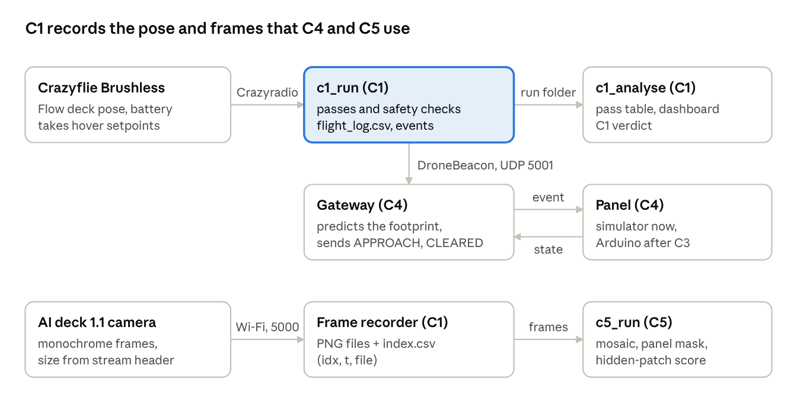

# DEIS Group 3: drone-aware solar panel actuation

A small closed-loop prototype for an agrivoltaic test bed: a drone shares its live position with an actuated solar panel, and the panel moves out of the camera's line of sight while the drone images the crops. DEIS course project, Halmstad University, autumn 2026.

This repository holds the shared code for the TG2 component checks:

| Check | Component | Package | Status (16 Oct 2026) |
| --- | --- | --- | --- |
| C1 | Drone: Crazyflie 2.1 Brushless, Lighthouse deck (lab base stations), AI deck 1.1 | `agri_loop/drone` | Built; tested on the simulator only |
| C4 | Message layer: CAM-like beacons, DENM-like events, over UDP | `agri_loop/link` | Built; tested in simulation and on local UDP |
| C5 | Offline vision: mosaic, panel mask, hidden-patch detection | `agri_loop/vision` | Built; tested on synthetic data |
| ROS2 | `agri_msgs` and `agri_ros` wrappers | `ros2_ws/src` | Written, not yet run |

Nothing has run on hardware yet. The step-by-step build guide (physical set-up and software for C1, C4 and C5) is in [docs/TG2_build_guide.md](docs/TG2_build_guide.md).



## Quick start

Python 3.9 is the tested version. From the repository root:

```bash
python -m venv .venv
.venv/Scripts/python -m pip install -r requirements.txt
.venv/Scripts/python -m pip install cflib==0.1.27 --no-deps
.venv/Scripts/python -m pytest -q
```

- On Linux or macOS use `.venv/bin/python` instead of `.venv/Scripts/python`.
- cflib is installed without its dependencies on purpose: cflib 0.1.27 declares numpy 1.x and would otherwise downgrade numpy 2.0.2. See the comments in `requirements.txt`.
- Expected result: 30 tests pass (drone 16, link 8, UDP 2, vision 4).
- To fly the real drone on Windows, the Crazyradio also needs the libusb driver (Zadig); see the build guide.

## Main commands

| What | Command |
| --- | --- |
| C1 on the simulator (no hardware) | `python -m agri_loop.drone.c1_run --sim` |
| C1 pre-flight, motors off | `python -m agri_loop.drone.c1_preflight --stream 10` |
| C1 real flight, 10 passes | `python -m agri_loop.drone.c1_run --fly` |
| C1 score one or more runs | `python -m agri_loop.drone.c1_analyse data/c1/<run> [<run> ...]` |
| C4 simulated harness | `python -m agri_loop.link.c4_run --loss 0 0.05 0.1 0.2 --minutes 10 --passes 20` |
| C4 real UDP, one machine | `python -m agri_loop.link.udp_nodes --role demo --seconds 90 --passes 3 --loss 0.1` |
| C4 report | `python -m agri_loop.link.c4_report "data/c4_real/*.jsonl"` |
| C5 synthetic demo | `python -m agri_loop.vision.c5_run --synthetic` |
| C5 on recorded C1 frames | `python -m agri_loop.vision.c5_run --gt <frames> --static <frames> --actuated <frames>` |

Every run writes its own folder under `data/` (ignored by Git). Simulated C1 outputs are marked SIMULATED; never present them as hardware results.

## Repository layout

```text
agri_loop/
  drone/    C1: AI deck stream recorder, Crazyflie wrapper, mission and safety, flight log, C4 beacon, simulator
  link/     C4: message set, gateway, panel simulator, simulated network, UDP transport, report
  vision/   C5: frame loader, panel mask, mosaic, metrics, synthetic data
ros2_ws/src/
  agri_msgs/  ROS2 message definitions
  agri_ros/   ROS2 nodes wrapping the gateway and panel simulator
tests/      pytest suite for all packages
docs/       build guide and figures
data/       run outputs (not in Git)
```

Shared conventions: logs are JSON lines through one `EventLog` class, times are host epoch seconds, and C1 frames are saved as PNG plus `index.csv` (`idx,t,file`), which C5 reads directly.

## Areas and owners

| Area | Folder | Owner role |
| --- | --- | --- |
| Drone operation and localisation (C1, C2) | `agri_loop/drone` | Drone |
| Message layer and ROS2 (C4) | `agri_loop/link`, `ros2_ws` | Communication |
| Vision (C5) | `agri_loop/vision` | Vision |
| Panel frame, servo and firmware (C3) | not in the repository yet | Panel |

## Contributing

Read [CONTRIBUTING.md](CONTRIBUTING.md) before your first pull request. In short: branch from `main`, keep to your own area, run the tests, open a pull request.

## References

1. Z. Yin, Y. Zhang, Q. Lei and F. Feng, "PrivAgriVolt: Privacy-Preserving Shadow-Aware Vision for Crop Stress Diagnosis in Agrivoltaic Photovoltaic Systems," *Electronics*, vol. 15, no. 8, art. 1762, 2026, doi: [10.3390/electronics15081762](https://doi.org/10.3390/electronics15081762).
2. Bitcraze documentation for the [Crazyflie 2.1 Brushless](https://www.bitcraze.io/products/crazyflie-2-1-brushless/), [AI deck](https://www.bitcraze.io/documentation/tutorials/getting-started-with-aideck/) and [Flow deck v2](https://www.bitcraze.io/products/flow-deck-v2/).

The papers themselves are not stored here; cite them by DOI.
