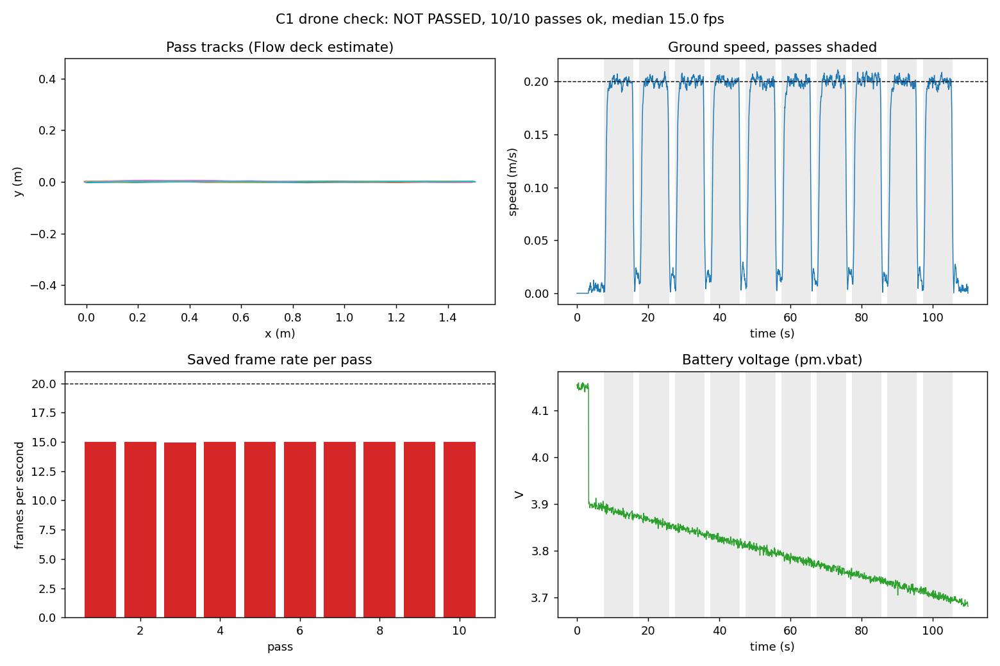

# DEIS Group 3: TG2 build guide for C1, C4 and C5

16 Oct 2026. Versioned copy of the team's TG2 build guide; update it in the same pull request as the code it describes.

## Overview

TG2 (Wed 21 Oct 2026) checks each component on its own before the loop is closed. This guide covers three of the six checks: C1 (drone), C4 (message layer) and C5 (offline vision). All three live in one Python package, `agri_loop`, in this repository, and share one run folder format under `data/`.

| Check | Component | What it proves | Pass criterion (TG1 plan) | Code |
| --- | --- | --- | --- | --- |
| C1 | Drone: Crazyflie 2.1 Brushless, Lighthouse deck with base stations, AI deck 1.1 | The drone flies repeatable straight passes and records images, pose and battery | 10 scripted straight passes at constant speed; frames saved at 20 fps or more (threshold to confirm); no crashes; battery log | `agri_loop/drone`, `python -m agri_loop.drone.c1_*` |
| C4 | Message layer (CAM-like beacons, DENM-like events) | Drone pose and panel events reach the other side on time | 10 minutes at 10 Hz; packet delivery ratio (PDR) and latency histogram; the same under emulated loss | `agri_loop/link`, `python -m agri_loop.link.c4_*` |
| C5 | Vision, offline | The image pipeline works on recorded flight frames | Mosaic, panel mask, crop index and red-patch detection on recorded video, with and without the panel in view | `agri_loop/vision`, `python -m agri_loop.vision.c5_run` |

- The drone changed since TG1: the Crazyflie now replaces the Tello as the imaging drone.
    - The AI deck 1.1 camera is monochrome, so C5 cannot use colour (ExG, red HSV range) on these frames. Section C5 explains the change.
- C1 output feeds the other two: its frames are the C5 input, and its flight log is the pose stream that C4 and the later C6 loop test replay.
- Each section below has the same order: physical set-up first, then software, then the commands to run, then what counts as a pass.

One C1 run produces the flight log, the frames for C5 and, with `--beacon`, the live pose stream for the C4 gateway.

## Shared hardware

One drone stack, one laptop and one scene serve all three checks. Check every row on the actual units before Monday 19 Oct, because two of them (camera direction and frame rate) can change the plan.

| Item | Role | Key facts | Check on our unit |
| --- | --- | --- | --- |
| [Crazyflie 2.1 Brushless](https://www.bitcraze.io/products/crazyflie-2-1-brushless/) | Flying platform | 34 g take-off weight with legs; about 10 min flight on the stock 350 mAh LiPo; 40 g recommended payload; must be armed before the motors spin | Firmware up to date; propellers on the right motors (CW marked 55-35R, CCW 55-35); guards fitted |
| [Lighthouse deck](https://www.bitcraze.io/documentation/tutorials/getting-started-with-lighthouse/) | Absolute position and height, so the drone can hold a line | Four light sensors and an FPGA; mounted on top, "FRONT UP"; needs the lab's Lighthouse base stations | `deck.bcLighthouse4 = 1`; Lighthouse status 2 with 2 or more base stations in the pre-flight report |
| Lighthouse base stations (in the lab) | Sweep the room with infrared light that the deck times | 2 to 4 V2 (or 2 V1) cover about 4 x 4 x 2 m; mounted above the flight area | Powered, unique channels, geometry estimated (see Lighthouse set-up) |
| [Flow deck v2](https://www.bitcraze.io/products/flow-deck-v2/) (backup, not fitted) | Height and velocity from the floor | Ours fails its self-test (both sensors silent, 16 Oct), so it is removed; a failing deck stops the drone from arming | Refit only if repaired: `deck.bcFlow2 = 1` and no five-blink LED |
| [AI deck 1.1](https://www.bitcraze.io/documentation/tutorials/getting-started-with-aideck/) | Camera and Wi-Fi image stream | GAP8 processor, ESP32 Wi-Fi, HM01B0 **monochrome** camera; 324x244 (QVGA build) or 324x324 (native build) | `deck.bcAI = 1`; which way the camera looks; frame rate over Wi-Fi |
| Crazyradio 2.0 or PA | Commands and logs between laptop and drone | Our drone: `radio://0/80/2M/E7E7E7E715` (factory default ends in E7); the C1 tools use it unless `--uri` or `AGRI_CF_URI` says otherwise | Set the cfclient Address box to `0xE7E7E7E715` before Scan |
| Laptop (Windows) | Runs `agri_loop`, records the stream, scores the runs | Must join the AI deck Wi-Fi "WiFi streaming example" while the radio is plugged in | Wi-Fi and radio work at the same time |
| Raspberry Pi or second laptop (C4 only) | Gateway and panel roles on a real network | UDP ports 5001 to 5003; clocks synchronised with chrony when on two machines | Both machines on one network |
| Spare batteries and charger | At least three charged packs | The stock pack charges over micro-USB on the drone | Resting voltage 4.1 V or more before a run |
| Scene | Floor the drone flies over | Matt, textured surface (artificial turf or printed mat); tape marks for the take-off point and the pass line; lamp on a fixed stand; a white paper patch for C5 | Room at least pass length plus 1 m, height 2 m or more |
| Safety | Protect people and parts | Propeller guards, a net or a marked keep-out zone, battery unplugged when not flying | Fire-safe LiPo bag for charging |

Deck stack, bottom to top:

1. Lighthouse deck on top, "FRONT UP" arrow forward, its four sensors uncovered; it holds the battery in.
2. Battery with the foam pad.
3. Crazyflie 2.1 Brushless main board.
4. AI deck underneath on the long pins and the wide spacer, the green holder turning the camera to look down.
5. Flow deck v2: not fitted (see the table). If a working one is added, it goes at the very bottom.

- Mount each deck facing the drone's front, which is the antenna bump side (the blue LEDs are at the back). Bitcraze notes that this orientation matters for decks.
- The ESP32 antenna on the AI deck breaks easily in a crash. Bitcraze suggests a dab of hot glue on it.
- Bitcraze's deck matrix marks Lighthouse and AI deck as compatible, with one note: the AI deck's GAP8 uses UART1, so a firmware build that enables UART1 conflicts. The standard image streamer does not use it.

## Software set-up

Every command in this guide runs from the repository root with the project's own Python 3.9 environment (`.venv`). On Linux or macOS replace `.venv\Scripts\python` with `.venv/bin/python`. Do steps 1 to 6 once per laptop; step 6 should end with 30 tests passing.

1. Install the Crazyflie client (cfclient) in its own environment, not in `.venv`.
    - Bitcraze warns that `opencv-python` conflicts with cfclient, and `.venv` has OpenCV.
    - cfclient is only used for firmware updates and a hand-held arming test.
2. Install the Crazyradio USB driver on Windows: plug in the Crazyradio, open Zadig, select the Crazyradio, choose libusb (libusb-win32) and click Install ([Bitcraze Windows USB driver page](https://www.bitcraze.io/documentation/repository/crazyradio-firmware/master/building/usbwindows/)). If the link is unreliable, reinstall with libusbK. cflib looks for this driver on Windows; without it the scan prints "No backend available". See also the [Brushless getting-started guide](https://www.bitcraze.io/documentation/tutorials/getting-started-with-crazyflie-brushless/).
    - Check: cfclient → Scan lists the drone.
3. Update the Crazyflie and AI deck firmware with cfclient: Connect → Bootloader → Scan → choose the `radio://` address → latest release for the 2.1 Brushless → Program.
    - The ESP32 part on the AI deck takes about 3 minutes ([AI deck guide](https://www.bitcraze.io/documentation/tutorials/getting-started-with-aideck/)).
    - Check: the cfclient console shows `ESP32: I (910) SYS: Initialized`.
4. Flash the Wi-Fi image streamer onto the AI deck's GAP8 processor:
    - Download `aideck_gap8_wifi_img_streamer_with_ap.bin` from the aideck-gap8-examples releases page.
    - Run `cfloader flash aideck_gap8_wifi_img_streamer_with_ap.bin deck-bcAI:gap8-fw -w radio://0/80/2M/E7E7E7E715` (about 10 s).
    - Check: a Wi-Fi network called "WiFi streaming example" appears. The stream is at `192.168.4.1`, TCP port 5000.
    - The prebuilt file is the default build (raw frames, QVGA, start-stop capture). A JPEG or pipelined build is faster but needs the Docker toolchain; see C1 step 3.
5. Create the environment and install the packages:
    - `python -m venv .venv`, then `.venv\Scripts\python -m pip install -r requirements.txt`.
    - Then `.venv\Scripts\python -m pip install cflib==0.1.27 --no-deps`. cflib 0.1.27 is the newest release for Python 3.9 and asks for numpy 1.x; a plain install would downgrade numpy from 2.0.2 to 1.26.4, so it is installed without dependencies.
    - With numpy 2.0.2, 57 of 60 cflib modules import; the 3 that do not need optional extras we do not use (`yaml` for Lighthouse and LPS files, and a native link driver). `pip check` reports the numpy and packaging version mismatch; that is expected.
6. Run the test suite: `.venv\Scripts\python -m pytest -q`. Expected: 30 passed (drone 16, link 8, UDP 2, vision 4).

Repository layout:

| Folder | What it holds | Owner role |
| --- | --- | --- |
| `agri_loop/drone` | C1: AI deck stream (`cpx_stream`), Crazyflie wrapper (`vehicle`), passes and safety (`mission`), flight and battery log (`flightlog`), beacon to C4 (`beacon`), simulator (`sim`), commands `c1_preflight`, `c1_run`, `c1_analyse` | Drone |
| `agri_loop/link` | C4: message set, gateway, panel simulator, simulated network, UDP transport, commands `c4_run`, `udp_nodes`, `c4_report` | Communication |
| `agri_loop/vision` | C5: frame loader, panel mask, mosaic, metrics, synthetic data, command `c5_run` | Vision |
| `ros2_ws/src` | ROS2 packages `agri_msgs` and `agri_ros` (not yet run; need Ubuntu 24.04 with ROS2 Jazzy) | Communication |
| `tests` | `test_drone.py`, `test_link.py`, `test_udp.py`, `test_vision.py` | All |
| `data` | One folder per run: `c1/<date_time>`, `c4/<date_time>`, `c4_real`, `c5/<date_time>` (not in Git) | All |

- Shared formats: all logs are JSON lines through one `EventLog` class, all times are laptop epoch seconds, and C1 frames are written exactly as C5 reads them (PNG files plus `index.csv` with columns `idx,t,file`).

## Lighthouse set-up (positioning)

The drone flies on the lab's Lighthouse base stations. Set them up once per room layout ([Bitcraze Lighthouse guide](https://www.bitcraze.io/documentation/tutorials/getting-started-with-lighthouse/)).

1. Mount 2 to 4 base stations at least 0.5 m above the flight area, angled down, with a clear view of the whole pass line. Remove mirrors and shiny objects; avoid direct sunlight.
2. Give each base station a unique channel. V2: cfclient, View, Tabs, Lighthouse Positioning, "Set BS Channel" (channels 1 to 4). V1: modes b and c without a sync cable.
3. Connect cfclient to the drone, click "Switch BS version" and pick the version. Leave the drone in view of all base stations for about 20 s to receive calibration data.
4. Click "Start set up" and take the samples:
    - Origin: the drone on the take-off cross. This becomes (0, 0, 0).
    - X axis: the drone 1 m along the pass line. This makes the pass line the x axis, which the C1 passes follow.
    - XY plane: a few points on the floor off the line.
    - XYZ space: hold the drone at a few heights along the line, turning it slowly until each sample is confirmed.
5. Check: the deck's LED turns green, the 3D view shows each base station and the drone as a blue dot, and moving the drone by hand moves the dot without jumps. Sample errors above 10 mm mean a sample should be deleted or more samples added.
6. The geometry is stored on the drone. Redo it only if a base station moves.

People, the panel and the lamp stand must not block the base stations' view of the drone during a pass.

## C1 Drone: physical set-up

C1 needs a 1.5 m straight line over a matt, textured floor, a drone that starts on the same mark facing the same way every time, and a camera that looks at the floor. Set it up in this order.

1. Mark the floor.
    - Tape a take-off cross. Tape the pass line from it, 1.5 m long, with a mark every 0.25 m.
    - The drone flies out along the line and back, so the room needs the line plus 0.5 m at each end (the software geofence) plus a margin.
    - Tape a keep-out zone at least 1 m around the line.
2. Cover the line with the crop-bed surface (artificial turf or a printed mat). Lighthouse does not need floor texture, but the camera does: C5 stitches frames by their features, so a plain floor will not stitch.
3. Light the area evenly and keep the lamp in one fixed position. Mark the lamp stand on the floor.
4. Assemble the drone as in Shared hardware: Lighthouse deck on top, AI deck underneath, guards on, propellers checked.
5. Check which way the camera looks. This decides whether C5 works.
    - With the AI deck on top, the camera on its front edge looks forward, not down. Confirm it on our unit in C1 software step 2.
    - C5 maps frames with a similarity transform and assumes a downward view, so a forward view will not stitch.
    - Option A (recommended): a small 45° front-surface mirror in a light 3D-printed holder in front of the lens. The image is then mirrored; correct it with `--flip` (h, v or hv, chosen from the first test image).
    - Option B: accept an oblique view for C1 only and solve the downward view before Exp 1.1.
    - Weigh the stack with the holder: the recommended payload is 40 g.
6. Charge the batteries. A pack should read 4.1 V or more at rest. The software refuses to take off below 3.8 V.
7. Place the drone on the take-off cross, front (antenna bump) pointing along the pass line, then switch it on.
    - Keep it still and level until calibration ends: LED 1 blinking red twice a second means ready.
    - Lighthouse gives absolute position, so the passes always run along the x axis set in the Lighthouse set-up, wherever the drone starts. Start on the cross facing along the line: the drone holds heading 0, and the pre-flight warns if it faces more than 15 deg off.
8. Connect the laptop: Crazyradio in a USB port, laptop Wi-Fi joined to "WiFi streaming example". The laptop loses internet access while joined; that is expected.
9. Agree the roles: one person at the laptop (Ctrl+C lands the drone), one safety person at the edge of the keep-out zone, nobody inside it.
10. Keep the default height of 0.6 m over the soft mat.
    - If the radio link drops, the laptop can no longer command a landing, and the firmware stops the motors on its own after a short timeout. A low height over a soft surface limits the damage.

The C2 overhead camera is the independent check of these passes (the logged pose is the drone's own estimate). If C2 is ready, film every C1 run from above and keep the video with the run folder.

## C1 Drone: software

Three commands cover C1: `c1_preflight` (motors off), `c1_run` (flies and records) and `c1_analyse` (scores). The full chain already runs on the simulator: 10 of 10 passes at 0.199 m/s, battery logged, and a frame-rate fail at 15 fps, which is the simulated camera rate and shows the check works.

1. Dry run on the simulator, no hardware:
    - `.venv\Scripts\python -m agri_loop.drone.c1_run --sim`
    - It runs the same mission, recorder and analysis against a simulated drone and a fake AI deck that speaks the real stream format. Every output is marked SIMULATED. Use it to check the laptop and to learn the outputs, never as a result.

2. Pre-flight with the motors off:
    - `.venv\Scripts\python -m agri_loop.drone.c1_preflight --stream 10`
    - Checks: positioning (Lighthouse status 2 with at least 2 base stations, or a working Flow deck), AI deck present (`deck.bcAI`), position, velocity and battery log variables exist in the firmware, battery 3.8 V or more, drone level, supervisor allows arming.
    - Then it records 10 s from the AI deck and prints frame size, raw or JPEG, and frames per second. Frame size is always read from the stream header (324x244 or 324x324), never assumed.
    - Open the first PNG in `data\c1\<date_time>_preflight\frames`. Hold a printed arrow under the camera to see the view direction and pick `--flip` for the mirror.

3. Decide the frame-rate threshold from the measured value.
    - The 20 fps target was written for the Tello. The AI deck sends frames over its ESP32 Wi-Fi link, and we expect it to fall short of 20 fps with raw frames.
    - Faster builds of the streamer: `STREAM_ENCODING=jpeg` (smaller frames) and `CAPTURE_MODE=pipelined` (capture while sending). Both need the GAP8 Docker toolchain.
    - What the pipeline really needs is overlap between frames. With ground speed v, footprint length L along the pass and overlap o, the minimum rate is v divided by ((1 minus o) times L). Measure L with a tape at 0.6 m height.
    - Example only: v = 0.2 m/s, o = 0.6 and L = 0.4 m give 1.25 fps; 5 fps gives a safe margin. Propose the number with this formula at TG2 and rescore with `--fps-min`.

4. First short flight: `.venv\Scripts\python -m agri_loop.drone.c1_run --fly --passes 1 --length 0.5 --label hover`
    - Watch that the drone takes off straight, holds the line and lands on the mark.
5. Full C1 run: `.venv\Scripts\python -m agri_loop.drone.c1_run --fly --flip <choice>`
    - Defaults: 10 passes, 1.5 m, 0.2 m/s, 0.6 m height, 2 s hover between passes, passes alternate out and back on one line.
    - Order: pre-flight checks, 2 s camera check, 3 s countdown, arm, take off over 2.5 s, settle 2 s, passes, land, disarm, analysis.
    - Each pass ramps up at 0.4 m/s², holds 0.2 m/s, brakes to stop on the end mark, and corrects sideways drift and heading with small proportional terms (at most 0.1 m/s).
6. If one battery does not last: fly `--passes 5 --label bat1`, swap and re-place the drone on the cross, fly `--passes 5 --label bat2`, then score both together:
    - `.venv\Scripts\python -m agri_loop.drone.c1_analyse data\c1\<bat1 folder> data\c1\<bat2 folder>`
7. Optional join to C4: add `--beacon <gateway IP> --beacon-offset <x> <y>` and the run also sends the live pose to the C4 gateway as DroneBeacon messages at 10 Hz (see C4).

Safety, checked 20 times a second in flight:

| Trigger | Action |
| --- | --- |
| Ctrl+C, radio link lost, battery under 3.3 V for 1 s or firmware low-power state, drone outside the geofence (0.5 m beyond the line or above 1.1 m) | Land on the spot, then disarm |
| Tilt over 45° or the supervisor reports tumbled or crashed | Motors off at once |
| Battery under 3.8 V, a deck missing or the camera silent before take-off | Refuse to take off |

What one run folder (`data\c1\<date_time>_<label>`) contains:

- `config.json`: command-line arguments and mission settings.
- `events.jsonl`: pre-flight report, stream check, armed, take-off, every pass start and end, land, any abort.
- `flight_log.csv`: 20 rows a second with x, y, z, vx, vy, vz (drone's estimate), roll, pitch, yaw, battery voltage and level, power state, supervisor bits, and Lighthouse status and active base stations.
- `frames\`: PNG frames, `index.csv` (`idx,t,file`, read directly by C5) and `meta.csv` (size, format, bytes, arrival times).
- `c1_summary.md` and `c1_summary.json`: the verdict; `c1_passes.csv`: one row per pass.
- `c1_dashboard.png` (pass tracks, speed, frame rate per pass, battery) and `c1_frames.png` (one frame from each pass) for the slides.

Example dashboard from a simulated run (not a hardware result):

How each part of the criterion is measured. The speed and straightness thresholds are ours, so state them at TG2:

| Criterion | Measured as | Default threshold | Change with |
| --- | --- | --- | --- |
| 10 straight passes at constant speed | Steady part of each pass (ramp and braking removed): mean speed within 15 % of the command, speed variation (CV) at most 0.15, sideways RMS at most 0.10 m, pass reached its end mark | 10 passes | `--speed-tol`, `--cv-max`, `--lateral-max` |
| Frames saved at the target rate | Saved frames per second inside each pass; the lowest pass counts | 20 fps (plan); propose a new value from step 3 | `--fps-min` |
| No crashes | No tilt over 45°, no tumble or crash flag, no motor cut, every run landed | none allowed | none |
| Battery log | Voltage logged through the whole flight with no gap over 1 s | 1 s | none |

## C4 Message layer

C4 shows that drone pose and panel events cross the link on time, with and without packet loss. It is built and tested in software (simulated network and real UDP on one laptop); the run across two machines and the run with the real drone are still to do.

Message set (`agri_loop/link/messages.py`), modelled on C-ITS:

| Message | Like | Rate | Delivery |
| --- | --- | --- | --- |
| DroneBeacon: position, velocity, heading, mission type | CAM (awareness) | 10 Hz | Best effort: a lost beacon is replaced by the next one |
| PanelEvent: APPROACH, CLEARED or ABORT with target angle | DENM (event) | When the drone enters or leaves the zone | Acknowledged and resent every 0.3 s, up to 10 times |
| PanelState: angle, target, state, current, last acknowledged event | Status | 20 Hz | Best effort |
| Heartbeat | Watchdog | 5 Hz | Best effort; 1 s without one sends the panel to its safe state |

Every message carries a sequence number and a send time, so delivery ratio and latency come straight from the logs.

### Physical set-up

1. One laptop is enough for steps 1 and 2 below.
2. For step 3, put the gateway and panel roles on a Raspberry Pi (or second laptop) and the drone role on the laptop, both on the same network.
    - Synchronise both clocks with chrony, otherwise one-way latency is wrong.
    - Loss on a real link is injected on Linux with `tc netem` (for example `sudo tc qdisc add dev wlan0 root netem loss 10%`, removed with `sudo tc qdisc del dev wlan0 root`). Windows has no netem; there the software loss option is the stand-in.
3. For step 4, the bed frame is the Lighthouse frame: origin on the C1 take-off cross, x along the pass line, as set in the Lighthouse set-up. The gateway's default panel zone is x 0.4 to 0.8 m, y -0.3 to 0.3 m, so put the panel (or a marked stand-in) at x = 0.6 m on the line.
4. The real panel (Arduino, servo, IMU) is not part of C4 yet. The panel role is the panel simulator, with a 90°/s slew rate to be replaced by the C3 measurement.

### Software steps

1. Simulated harness, 10 minutes per loss level, 20 passes:
    - `.venv\Scripts\python -m agri_loop.link.c4_run --loss 0 0.05 0.1 0.2 --minutes 10 --passes 20`
    - Output in `data\c4\<date_time>`: `summary.json`, `summary.csv`, `latency.png` and one log per loss level.
    - Reports, per loss level: delivery ratio per stream, one-way latency median and 95th percentile, event to angle reached, resends, failed events, faults, and timing success (panel at target before the camera footprint enters the zone).
2. Real UDP sockets on one laptop:
    - `.venv\Scripts\python -m agri_loop.link.udp_nodes --role demo --seconds 90 --passes 3 --loss 0.1`
3. Real UDP across machines, one role per terminal (ports 5001 gateway, 5002 panel):
    - `.venv\Scripts\python -m agri_loop.link.udp_nodes --role gateway --out data/c4_real`
    - `.venv\Scripts\python -m agri_loop.link.udp_nodes --role panel --out data/c4_real`
    - `.venv\Scripts\python -m agri_loop.link.udp_nodes --role drone --out data/c4_real --passes 20`
    - Add `--host-gateway <IP>` and `--host-panel <IP>` when the roles are on different machines.
    - Score: `.venv\Scripts\python -m agri_loop.link.c4_report "data/c4_real/*.jsonl"` (`--json` for machine-readable output).
4. Real drone as the beacon source (the join between C1 and C4):
    - Start the gateway and panel roles as in step 3, without the drone role.
    - Fly C1 with `--beacon <gateway IP>`. The live Lighthouse pose goes out as DroneBeacon at 10 Hz, mission type CROP_OCCLUSION during passes and NONE between them. With Lighthouse the pose is already in the bed frame, so leave `--beacon-offset` at 0.
    - The sends are logged as `drone.jsonl` in the C1 run folder. Score with `c4_report data/c4_real/gateway.jsonl data/c4_real/panel.jsonl data/c1/<run>/drone.jsonl`.
    - The panel should then move as the real drone passes x = 0.6 m: a first, informal look at C6.

Results so far (software only):

| Run | Beacon delivery | Events reached / failed | Event to angle, median / p95 (ms) | Timing success | Panel faults |
| --- | --- | --- | --- | --- | --- |
| Simulated, 0 % loss | 1.000 | 20 / 0 | 798 / 812 | 1.00 | 0 |
| Simulated, 5 % loss | 0.950 | 20 / 0 | 798 / 827 | 1.00 | 0 |
| Simulated, 10 % loss | 0.897 | 20 / 0 | 800 / 862 | 1.00 | 0 |
| Simulated, 20 % loss | 0.791 | 19 / 0 | 810 / 1132 | 0.95 | 4 |
| Real UDP, one laptop, 5 % loss | 0.959 | all reached | 766 (median) | not reported | not reported |

Simulated rows: run of 16 Oct 2026, 10 min per level, 20 passes (`c4_run` defaults). At 20 % loss, five heartbeats lost in a row tripped the 1 s watchdog, so the panel went to its safe state and one pass missed its event. Beacon delivery is about 1 minus the loss rate, so only the 0 % and 5 % runs meet the 95 % target.

Pass criteria to state at TG2:

- Event to angle reached: median 2 s or less over 20 or more runs (NFR-1).
- Beacon delivery: 95 % or more at 10 Hz (NFR-3). Report it separately from event delivery, because beacons are best effort and events are acknowledged.
- Timing success: panel at target before the footprint arrives in 90 % or more of passes (NFR-4).
- Report all of them at 0, 5, 10 and 20 % loss; the 20 % case shows the watchdog working, not a failure of the design.

## C5 Offline vision

C5 shows that the image pipeline turns recorded flight frames into a mosaic, masks the panel, and finds a patch hidden under it. It works on synthetic data and reads real C1 frame folders directly; it has not yet seen real AI deck frames.

One change from the TG1 plan: the AI deck camera is monochrome, so there is no Excess Green index and no red HSV test. The hidden patch becomes a bright white paper patch, found by its grey level against the vegetation.

### Physical set-up

1. Build the crop bed under the C1 pass line (turf or plants), with the same tape marks.
2. Place the panel mock-up (dark, as in the real build) horizontal over the bed at x = 0.6 m, the same spot as the C4 panel zone. A panel turned vertical rises towards the drone. (With Lighthouse the drone keeps its height over the panel; a Flow deck would make it climb by the panel's height.) The panel must also not block the base stations' view of the drone. Keep the top of the vertical panel at least 0.3 m below flight height (raise flight height with `--height`), and test one slow pass with the panel vertical before recording.
3. Put a white paper patch on the bed under the panel, where a static panel hides it from the camera.
4. Fix the lamp and the room light for all three recordings. The camera adjusts its exposure on its own, so a change in light changes the grey levels between recordings.
5. Solve the camera direction first (C1 set-up step 5). The pipeline assumes a downward view.
6. Record three passes over the same bed with the same height, speed and line, each as its own C1 run:
    - `gt`: panel removed (ground truth).
    - `static`: panel horizontal and fixed (the control).
    - `actuated`: panel turned vertical as the drone approaches. Until the C6 loop works, one person tilts it by hand when the drone reaches the 0.25 m mark.
    - Commands: `.venv\Scripts\python -m agri_loop.drone.c1_run --fly --passes 1 --label gt`, then the same with `--label static` and `--label actuated`.

### Software steps

1. Synthetic demo, no hardware:
    - `.venv\Scripts\python -m agri_loop.vision.c5_run --synthetic`
    - Result so far: static panel 0.846 of the crop visible and patch not found; actuated 0.994 visible and patch found (area ratio 1.01); registration error about 2 px, no failures.
2. Real frames from the three C1 runs:
    - `.venv\Scripts\python -m agri_loop.vision.c5_run --gt data\c1\<gt>\frames --static data\c1\<static>\frames --actuated data\c1\<actuated>\frames`
    - `--step 2` uses every second frame. A video file also works for any of the three inputs.
    - Output in `data\c5\<date_time>`: `c5_metrics.json` and `c5_overview.png`.
3. What the pipeline does with each recording:
    1. Panel mask per frame: blur, keep pixels darker than 0.45 of the 75th-percentile grey level, close and open, keep large compact regions, fill the convex hull (glare on a glossy panel is bright), grow by 5 px.
    2. Register: SIFT features outside the mask, a similarity transform with RANSAC between consecutive frames, falling back to two and three frames back, then to the last motion; chain the transforms.
    3. Mosaic: mean of the unmasked observations of each pixel; pixels never seen unmasked are flagged as unobserved (the occlusion no processing can fix).
    4. Align the static and actuated mosaics onto the ground-truth mosaic.
    5. Score against ground truth: visible crop ratio, hidden-patch recall, patch area ratio, mean grey-level error.
4. Calibrate on the first real frames. The mask threshold (0.45) and the patch threshold (z of 4.0, smoothing sigma 5) were tuned on synthetic data. Check the masks in `c5_overview.png` and adjust before scoring.

The C1 to C5 hand-off is tested: C5 loaded 1,647 frames from a simulated C1 run folder through its `index.csv` with no registration failures.

Pass criteria to state at TG2:

- A mosaic is built from each recording with no registration failures.
- The panel is masked in the frames where it is in view, and nowhere else.
- The patch is found in the actuated mosaic and not in the static one.
- Visible crop ratio of the actuated mosaic is 0.90 or more of ground truth (NFR-5 hypothesis).

## TG2 day

Show each check the same way: what was set up, the run, the figure the software made from it, and the pass table against the criterion. Every figure below is generated by the commands in this guide, so the slides come straight from the run folders.

| Order | Check | Live in the room | On the slides | Files |
| --- | --- | --- | --- | --- |
| 1 | C1 | A 3-pass run (`--passes 3`) to save battery; the full 10-pass run is shown from the recording | Dashboard, one frame per pass, pass table, the frame-rate threshold and its formula | `c1_dashboard.png`, `c1_frames.png`, `c1_summary.md` |
| 2 | C5 | Not live | Overview of the gt, static and actuated mosaics with the patch result | `c5_overview.png`, `c5_metrics.json` |
| 3 | C4 | `udp_nodes --role demo --seconds 90 --passes 3 --loss 0.1`, then `c4_report` | Latency figure and the loss table (0, 5, 10, 20 %) | `latency.png`, `summary.csv` |
| 4 | C1 + C4 (if time) | C1 with `--beacon`: the simulated panel reacts to the real drone | One screenshot of the gateway log | `gateway.jsonl`, `drone.jsonl` |

- Slides carry the bullets and figures only; the explanation of each bullet goes in the presenter notes.
- Label any synthetic or simulated figure as such on the slide. The C1 tools already print SIMULATED on those outputs.

Rehearsal plan:

- [ ] Mon 19 Oct: software set-up steps 1 to 6 on the demo laptop; C1 pre-flight with a 10 s stream; camera direction and frame rate measured; threshold proposal written.
- [ ] Mon 19 Oct: first short flight (1 pass, 0.5 m).
- [ ] Tue 20 Oct: two full 10-pass C1 runs; C5 recordings (gt, static, actuated); C5 thresholds checked on real frames.
- [ ] Tue 20 Oct: C4 across two machines with chrony; optional C1 run with `--beacon`.
- [ ] Tue 20 Oct: slides built from the run folders; presenter notes written.
- [ ] Wed 21 Oct morning: batteries charged, laptop on the AI deck Wi-Fi, `pytest -q` shows 30 passed, the 3-pass live run rehearsed once.

## Risks and open checks

No part of C1, C4 or C5 has run on hardware yet. All C1 code is tested only against the simulator, so Monday's first session decides most of the rows below.

| Risk | Effect if it happens | What to do |
| --- | --- | --- |
| AI deck camera looks forward, not down | C5 cannot stitch the frames | 45° mirror with `--flip`; confirm in C1 pre-flight on Monday |
| Frame rate over Wi-Fi below 20 fps | C1 frame-rate check fails | JPEG or pipelined streamer build; propose the threshold from the overlap formula |
| Camera is monochrome | No Excess Green and no red patch, as written in the TG1 report (FR-4, Exp 1.1) | White patch and grey-level metrics; update the report text for TG2 |
| A vertical panel reaches towards the drone | Collision | Keep 0.3 m clearance; slow test pass first |
| Base stations blocked (people, panel, lamp) | Position lost mid-pass; the drone drifts or lands | Keep the view clear; the pre-flight needs 2 base stations; watch the Lighthouse LED |
| Flow deck fails its self-test | Five red blinks; the drone will not arm while the deck is fitted | Removed; Lighthouse is the positioning source |
| Logged pose is the drone's own estimate | Pass speed and straightness are judged on it | Film the passes with the C2 overhead camera as the independent check |
| Battery time with two decks and Wi-Fi | Fewer than 10 passes per pack | Split into two runs and score them together; three charged packs |
| cflib 0.1.27 installed against numpy 2.0.2, outside its declared range | A cflib function that uses numpy may fail on hardware (all imports and the tests pass) | Run the pre-flight before any flight; if cflib fails, a separate venv with numpy 1.26.4 is the fallback |
| Radio link lost in flight | The firmware stops the motors; the drone drops | 0.6 m height over a soft mat; keep-out zone |
| Laptop Wi-Fi is taken by the AI deck network | The laptop cannot reach the Raspberry Pi over Wi-Fi in C4 | Ethernet between laptop and Raspberry Pi |
| Camera auto exposure | Grey levels differ between the three C5 recordings | Constant lamp and room light; calibrate C5 on real frames |
| Simulated loss is not real Wi-Fi loss | C4 numbers look smoother than reality | `tc netem` on Linux for the TG2 numbers; say which method each number comes from |
| ROS2 packages not run | ROS2 claims at TG2 cannot be backed | Present the plain Python layer as the C4 result; ROS2 after TG2 |

Checks to make on our own units, in the first hardware session:

- [ ] Pre-flight report shows positioning "lighthouse", `bcAI`, and no missing log variables.
- [ ] Arming works from our code (cflib 0.1.27 `send_arming_request`; untested on hardware).
- [ ] Heading hold turns the right way: in the first 1-pass flight the drone must not spin. If it does, press Ctrl+C and flip the sign of the yaw correction in `mission.py`.
- [ ] Frame size, format and frames per second from the stream.
- [ ] Camera view direction and the right `--flip` value.
- [ ] Flight time per pack with both decks.
- [ ] Ground footprint length at 0.6 m, measured with a tape, for the frame-rate formula.

## Sources

- [Crazyflie 2.1 Brushless product page](https://www.bitcraze.io/products/crazyflie-2-1-brushless/): weight, flight time, payload.
- [Getting started with the Crazyflie 2.1 Brushless](https://www.bitcraze.io/documentation/tutorials/getting-started-with-crazyflie-brushless/): assembly, propellers, LEDs, client and radio.
- [Getting started with the AI deck](https://www.bitcraze.io/documentation/tutorials/getting-started-with-aideck/): mounting, firmware, streamer flashing, Wi-Fi network.
- [AI deck Wi-Fi streamer example](https://www.bitcraze.io/documentation/repository/aideck-gap8-examples/master/examples/wifi-streamer/): build options (resolution, capture mode, JPEG).
- [opencv-viewer.py in aideck-gap8-examples](https://github.com/bitcraze/aideck-gap8-examples/blob/master/examples/other/wifi-img-streamer/opencv-viewer.py): stream packet format, IP 192.168.4.1, port 5000.
- [AI deck 1.1 datasheet](https://mouser.com/pdfDocs/ai_deck_1_1-datasheet.pdf): monochrome HM01B0 camera on version 1.1.
- [Getting started with Lighthouse](https://www.bitcraze.io/documentation/tutorials/getting-started-with-lighthouse/): base stations, channels, geometry estimation.
- [Lighthouse log variables](https://www.bitcraze.io/documentation/repository/crazyflie-firmware/master/api/logs/): `lighthouse.status` and `lighthouse.bsActive`.
- [Flow deck v2 product page](https://www.bitcraze.io/products/flow-deck-v2/): sensors, range, surface.
- [Expansion decks of the Crazyflie 2.x](https://www.bitcraze.io/documentation/system/platform/cf2-expansiondecks/): deck compatibility and pin lengths.
- [Crazyradio Windows USB driver](https://www.bitcraze.io/documentation/repository/crazyradio-firmware/master/building/usbwindows/): Zadig and libusb.
- [cflib supervisor API](https://www.bitcraze.io/documentation/repository/crazyflie-lib-python/master/api/cflib/crazyflie/supervisor/) and [arming in the firmware](https://www.bitcraze.io/documentation/repository/crazyflie-firmware/master/functional-areas/supervisor/arming/): arming on the Brushless.
- The group's TG1 revision document (not in the repository): TG2 checks C1 to C6, requirements FR and NFR, message set.
